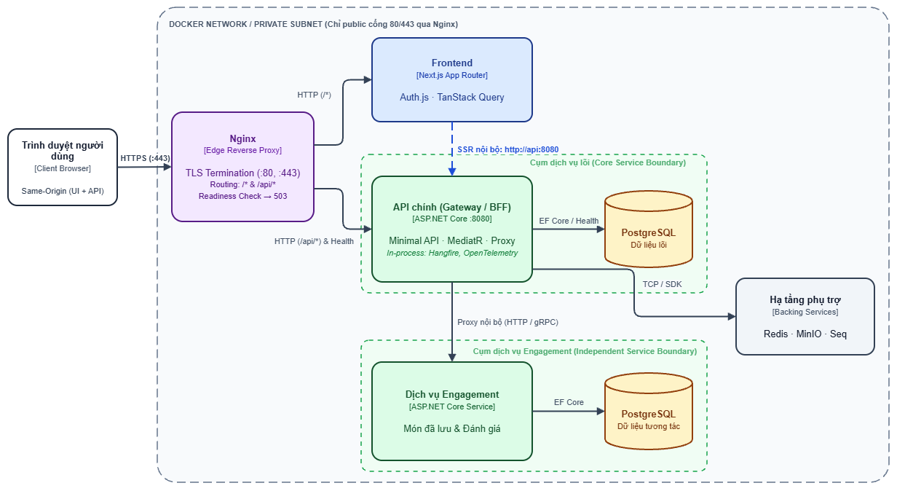
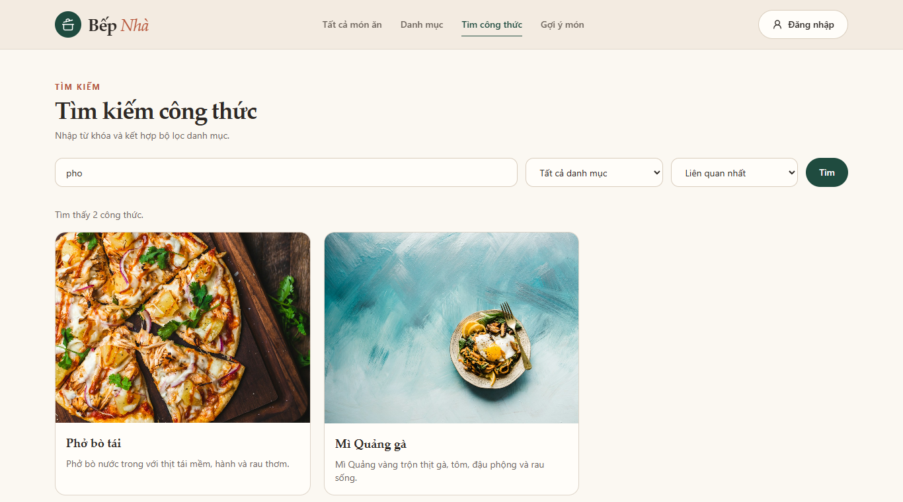
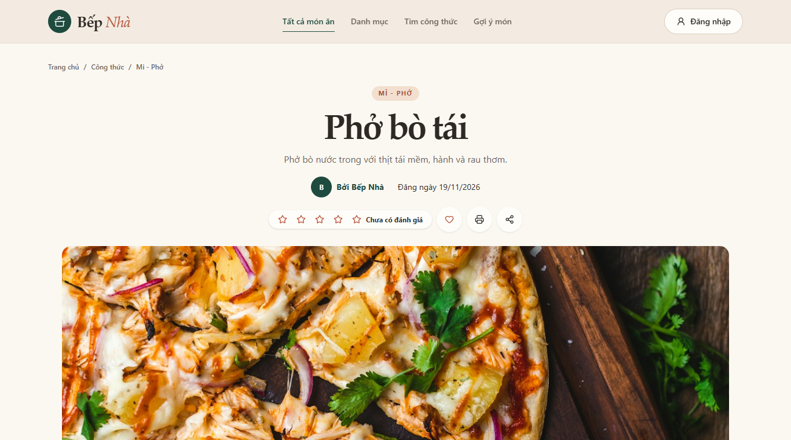
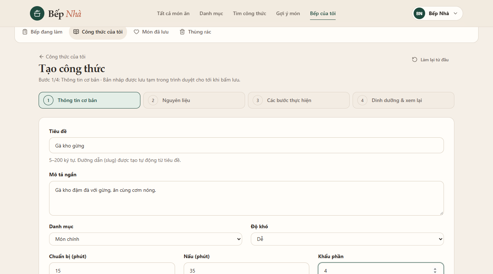
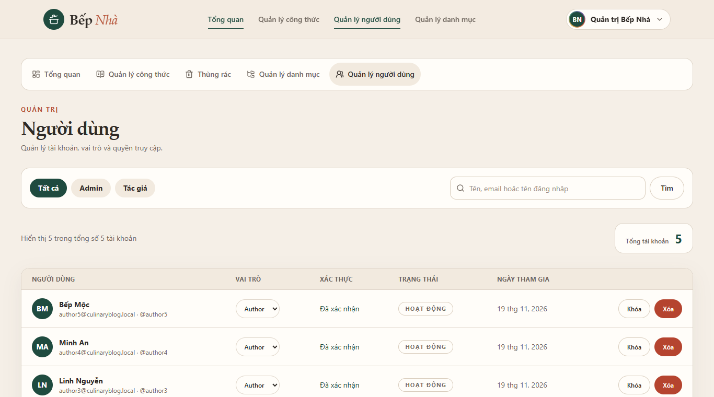

# BÁO CÁO MÔN HỌC

## XÂY DỰNG WEBSITE CHIA SẺ CÔNG THỨC NẤU ĂN CULINARY BLOG

**Trường:** Trường Đại học Đà Lạt  
**Khoa:** Công nghệ Thông tin  
**Môn học:** [Điền tên môn học]  
**Giảng viên hướng dẫn:** [Điền họ tên giảng viên]

| MSSV | Thành viên |
|---|---|
| 2312686 | Phan Lê Xuân Mạnh |
| 2314506 | Nguyễn Đình Thạch |
| 2312700 | Lý Ngọc Thảo Nguyên |
| 2312642 | Trần Tấn Khải |

**Đà Lạt, tháng 11 năm 2026**

<!-- page -->

# NHẬN XÉT CỦA GIẢNG VIÊN

............................................................................................................................

............................................................................................................................

............................................................................................................................

............................................................................................................................

............................................................................................................................

............................................................................................................................

............................................................................................................................

............................................................................................................................

**Đà Lạt, ngày ...... tháng ...... năm 2026**

**Giảng viên**  
*(Ký và ghi rõ họ tên)*

<!-- page -->

# TÓM TẮT

Culinary Blog là website hỗ trợ chia sẻ, tìm kiếm và quản lý công thức nấu ăn. Hệ thống gồm khu vực công khai dành cho người đọc, khu vực tác giả để biên soạn và quản lý công thức, cùng khu vực quản trị dành cho quản trị viên. Người dùng có thể tìm kiếm công thức tiếng Việt, xem nội dung chi tiết, lưu món và đánh giá từ 1 đến 5 sao.

Sản phẩm sử dụng Next.js cho frontend, .NET Minimal APIs cho backend và PostgreSQL cho dữ liệu. Backend chính được tổ chức theo Clean Architecture, CQRS và các mô-đun nghiệp vụ. Chức năng lưu món và đánh giá được đặt trong dịch vụ Engagement có cơ sở dữ liệu riêng. Các thành phần lưu ảnh, bộ nhớ đệm, công việc nền, email thử và quan sát hệ thống được cung cấp qua MinIO, Redis, Hangfire, MailHog, Serilog, Seq và OpenTelemetry.

Nhóm đã hoàn thành các luồng cốt lõi gồm đăng ký, đăng nhập, phân quyền, quản lý danh mục, quản lý công thức, tìm kiếm tiếng Việt, xử lý ảnh, quản trị người dùng, lưu món và đánh giá. Toàn bộ frontend, backend, Engagement, Nginx và các thành phần phụ trợ được đóng gói bằng Docker Compose. Nginx cung cấp một điểm truy cập HTTPS thống nhất; đăng nhập Google cần Client ID riêng để kích hoạt.

**Mã nguồn:** <https://github.com/xuanmanhneee/culinary-blog>

<!-- page -->

# CHƯƠNG 1. TỔNG QUAN ĐỀ TÀI

## 1.1. Lý do lựa chọn đề tài

Công thức nấu ăn là dạng nội dung có cấu trúc rõ ràng. Một công thức hoàn chỉnh không chỉ có tên món mà còn gồm mô tả, danh mục, thời gian chuẩn bị, thời gian nấu, khẩu phần, độ khó, danh sách nguyên liệu, các bước thực hiện, ảnh minh họa và thông tin dinh dưỡng. Nếu các phần này được lưu dưới dạng nội dung rời rạc, người đọc khó tìm kiếm, so sánh và thực hiện theo.

Website chia sẻ công thức đồng thời phục vụ nhiều nhóm người dùng. Khách cần xem và tìm món phù hợp. Tác giả cần soạn bản nháp, bổ sung nội dung rồi quyết định thời điểm xuất bản. Quản trị viên cần tổ chức danh mục, kiểm soát tài khoản và hỗ trợ quản lý nội dung. Ngoài ra, các chức năng như lưu món và đánh giá còn yêu cầu dữ liệu riêng theo từng tài khoản.

Đề tài vì vậy phù hợp để vận dụng kiến thức về xây dựng ứng dụng web, thiết kế API, mô hình dữ liệu, phân quyền, xử lý tệp, công việc nền và triển khai nhiều thành phần. Quy mô đề tài đủ lớn để các thành viên làm việc theo mô-đun nhưng vẫn có thể hoàn thành và trình diễn trong phạm vi môn học.

## 1.2. Mục tiêu

Mục tiêu sản phẩm là xây dựng một website cho phép:

- Khách xem, tìm kiếm và lọc các công thức đã xuất bản.
- Tác giả đăng ký, đăng nhập, tạo bản nháp và quản lý công thức của mình.
- Người dùng lưu món và đánh giá công thức từ 1 đến 5 sao.
- Quản trị viên quản lý công thức, danh mục và tài khoản người dùng.
- Hệ thống kiểm tra quyền, dữ liệu nhập và tệp ảnh tại backend.
- Nhóm có thể khởi động môi trường báo cáo bằng các lệnh thống nhất.

Về mặt học tập, nhóm hướng đến việc kết nối frontend, backend và cơ sở dữ liệu thành một sản phẩm hoàn chỉnh; tổ chức mã nguồn để các thành viên làm việc song song; sử dụng Git để tích hợp; và giải thích được các quyết định kỹ thuật trong buổi vấn đáp.

<!-- page -->

## 1.3. Phạm vi thực hiện

Phạm vi của phiên bản báo cáo gồm ba khu vực chính:

1. **Khu vực công khai:** danh sách công thức, tìm kiếm, lọc, phân trang và trang chi tiết.
2. **Khu vực tác giả:** đăng nhập, quản lý công thức, nguyên liệu, các bước, ảnh, trạng thái và danh sách món đã lưu.
3. **Khu vực quản trị:** quản lý công thức, danh mục và người dùng.

Mỗi công thức có vòng đời từ bản nháp đến xuất bản hoặc lưu trữ. Việc xóa được thực hiện theo hướng xóa mềm để có thể khôi phục. Chức năng tương tác gồm lưu món và đánh giá, trong đó mỗi người dùng chỉ có một đánh giá hiện hành cho mỗi công thức.

Các chức năng bình luận, nhắn tin, thanh toán, ứng dụng di động riêng và GraphQL không thuộc phạm vi. Môi trường báo cáo sử dụng Nginx làm reverse proxy và kết thúc TLS bằng chứng chỉ cục bộ; chứng chỉ do CA công khai cấp chỉ cần khi triển khai trên tên miền thật.

## 1.4. Phương pháp thực hiện

Nhóm bắt đầu từ đặc tả SRS để xác định tác nhân và phạm vi chức năng. Sau đó, công việc được chia theo các mô-đun Auth, Category, Recipe, Search, File, SEO, Jobs và DevOps. Các thành viên phát triển trên Git, tích hợp theo hợp đồng API và kiểm tra lại trên môi trường chạy chung.

Trong quá trình cài đặt, một số mô tả của SRS được làm rõ hoặc điều chỉnh để hệ thống thống nhất. Báo cáo này chỉ nêu những thay đổi ảnh hưởng trực tiếp đến sản phẩm, không trình bày lại toàn bộ SRS. Trọng tâm đánh giá là phần đã cài đặt, phần chưa hoàn thành, ảnh demo và khả năng cài đặt lại chương trình.

## 1.5. Công nghệ sử dụng

| Thành phần | Công nghệ |
|---|---|
| Frontend | Next.js 16, React 19, TypeScript, Tailwind CSS, Auth.js, TanStack Query |
| Backend chính | .NET 10 Minimal APIs, MediatR, FluentValidation, ASP.NET Core Identity, JWT |
| Dịch vụ Engagement | .NET 10, Entity Framework Core, PostgreSQL riêng |
| Dữ liệu | PostgreSQL 16, full-text search, `unaccent`, `pg_trgm` |
| Hạ tầng | Redis, MinIO, Hangfire, MailHog, Serilog, Seq, OpenTelemetry, Docker Compose |

<!-- page -->

# CHƯƠNG 2. PHÂN TÍCH YÊU CẦU

## 2.1. Tác nhân và quyền chính

| Tác nhân | Quyền chính |
|---|---|
| Khách | Xem công thức đã xuất bản, danh mục, kết quả tìm kiếm và điểm đánh giá |
| Tác giả | Tạo, sửa, xuất bản, lưu trữ, xóa và khôi phục công thức của mình; quản lý ảnh, nguyên liệu và bước; lưu món và đánh giá |
| Quản trị viên | Xem và quản lý mọi công thức; quản lý danh mục, vai trò và trạng thái tài khoản |

Phân quyền được kiểm tra theo ba lớp. Kiểm tra theo vai trò xác định nhóm quyền tổng quát. Kiểm tra theo tài nguyên bảo đảm tác giả chỉ chỉnh sửa công thức thuộc sở hữu của mình. Kiểm tra theo chính sách áp dụng các điều kiện bổ sung, chẳng hạn tài khoản tác giả phải được xác nhận trước khi thao tác nội dung.

## 2.2. Yêu cầu chức năng

| Nhóm | Nội dung chính | Hiện trạng |
|---|---|---|
| Xác thực | Đăng ký, đăng nhập, làm mới và thu hồi refresh token, hồ sơ, Google OAuth | Đã cài đặt; Google OAuth cần cấu hình |
| Danh mục | Danh sách, chi tiết, tạo, sửa và xóa mềm | Đã cài đặt |
| Công thức | Danh sách, chi tiết, bản nháp, sửa, xuất bản, lưu trữ, xóa mềm và khôi phục | Đã cài đặt |
| Thành phần công thức | Ảnh, nguyên liệu, bước thực hiện và dinh dưỡng | Đã cài đặt |
| Tìm kiếm | Tìm kiếm tiếng Việt không dấu, lọc, sắp xếp và phân trang | Đã cài đặt |
| Tương tác | Lưu, bỏ lưu món và đánh giá từ 1 đến 5 sao | Đã cài đặt |
| Quản trị | Quản lý danh mục, công thức và người dùng | Đã cài đặt |
| Vận hành | Công việc nền, health check, log và trace | Đã cài đặt |

<!-- page -->

## 2.3. Vòng đời công thức

Công thức mới được tạo ở trạng thái `Draft`. Ở trạng thái này, nội dung chỉ dành cho chủ sở hữu và quản trị viên. Khi tác giả xuất bản, hệ thống kiểm tra điều kiện nghiệp vụ và chuyển sang `Published`; công thức sau đó xuất hiện trên trang công khai và kết quả tìm kiếm. Khi chuyển sang `Archived`, công thức được giữ trong hệ thống nhưng không còn hiển thị công khai.

Xóa công thức là xóa mềm. Bản ghi được đánh dấu đã xóa thay vì bị loại khỏi cơ sở dữ liệu ngay lập tức. Cách làm này cho phép tác giả hoặc quản trị viên xem danh sách đã xóa và khôi phục khi cần. Các tệp liên quan được dọn bằng công việc nền để lỗi kho lưu trữ không làm giao dịch dữ liệu bị dở dang.

## 2.4. Yêu cầu phi chức năng

- **Bảo mật:** mật khẩu do ASP.NET Core Identity băm; JWT có thời hạn; refresh token được quay vòng; endpoint nhạy cảm có giới hạn tần suất.
- **Toàn vẹn dữ liệu:** không ghi đè thầm lặng khi nhiều phiên cùng sửa một công thức; các quan hệ quan trọng và dữ liệu duy nhất được kiểm soát.
- **Khả năng thay thế hạ tầng:** lưu tệp, cache và email được đặt sau interface để có thể đổi cách cài đặt.
- **Khả năng quan sát:** mỗi yêu cầu có correlation ID; log, trace, metric và health check hỗ trợ xác định lỗi.
- **Khả năng tìm kiếm:** trang công khai hỗ trợ SEO, metadata, JSON-LD và sitemap.
- **Khả năng cài đặt lại:** môi trường phát triển có Docker Compose, lệnh seed và tài khoản mẫu.

## 2.5. Tiêu chí nghiệm thu

Một hạng mục được xem là hoàn thành khi có mã nguồn tích hợp, có thể khởi động trong môi trường chung và có giao diện hoặc API tương ứng. Với chức năng phụ thuộc cấu hình bên ngoài, báo cáo ghi rõ trạng thái “hoàn thành có điều kiện”. Phần chưa được triển khai hoặc chưa xác nhận được ghi riêng thay vì gộp vào kết quả hoàn thành.

<!-- page -->

# CHƯƠNG 3. THIẾT KẾ HỆ THỐNG

## 3.1. Kiến trúc tổng thể

Hệ thống theo mô hình client–server hướng API. Frontend Next.js phục vụ giao diện công khai, khu vực tác giả và khu vực quản trị. Frontend gọi backend chính qua REST API. Backend chính xử lý xác thực, danh mục, công thức, người dùng và đồng thời làm điểm truy cập cho các yêu cầu tương tác.

Dịch vụ Engagement chịu trách nhiệm lưu món và đánh giá. Frontend không gọi trực tiếp dịch vụ này mà gửi yêu cầu qua backend chính. Engagement xác thực JWT bằng cùng cấu hình issuer, audience và khóa ký; khi cần, dịch vụ gọi backend chính để xác nhận công thức đang được xuất bản. Hai backend có hai cơ sở dữ liệu PostgreSQL riêng.



*Hình 3.1. Kiến trúc triển khai của Culinary Blog*

## 3.2. Tổ chức backend chính

Backend chính giữ bốn project Domain, Application, Infrastructure và API. Domain chứa mô hình nghiệp vụ và không tham chiếu các tầng bên ngoài. Application chứa command, query, handler, validator và interface. Infrastructure cài đặt truy cập dữ liệu và các dịch vụ hạ tầng. API cung cấp endpoint, middleware và cấu hình dependency injection.

Trong mỗi tầng, mã được chia tiếp theo mô-đun nghiệp vụ như Auth, Categories, Recipes và Users. Cách tổ chức này giữ chiều phụ thuộc của Clean Architecture nhưng giúp lần theo một chức năng từ endpoint đến dữ liệu dễ hơn so với việc đặt toàn bộ service, repository và DTO vào các thư mục kỹ thuật lớn.

<!-- page -->

## 3.3. CQRS và luồng xử lý yêu cầu

Các thao tác ghi được biểu diễn bằng command, còn thao tác đọc được biểu diễn bằng query. MediatR chuyển command hoặc query đến handler tương ứng. FluentValidation kiểm tra dữ liệu trước handler thông qua pipeline chung, nhờ đó endpoint không phải lặp lại cùng một kiểu kiểm tra.

Đường ghi sử dụng aggregate và Unit of Work để bảo vệ quy tắc nghiệp vụ. Đường đọc có thể dùng truy vấn phù hợp với danh sách, tìm kiếm và phân trang mà không buộc phải dựng toàn bộ aggregate. Sự tách biệt này giúp mỗi use case có đầu vào, đầu ra và trách nhiệm rõ ràng, nhưng làm số lượng tệp tăng. Với quy mô hiện tại, nhóm chấp nhận đánh đổi này để thuận lợi cho phân công và vấn đáp kỹ thuật.

## 3.4. Thiết kế dữ liệu

`Recipe` là thực thể trung tâm. Mỗi công thức thuộc một `Category` và một `Author`, đồng thời có nhiều `RecipeStep`, `RecipeIngredient` và `RecipeImage`. Thông tin dinh dưỡng được quản lý cùng công thức. `Slug` có chỉ mục duy nhất để tạo đường dẫn ổn định. `RowVersion` được sử dụng làm token kiểm soát cập nhật đồng thời.

Dữ liệu `SavedRecipe` và `Rating` thuộc cơ sở dữ liệu của Engagement. Chúng chỉ tham chiếu `RecipeId`, không có khóa ngoại xuyên cơ sở dữ liệu. Mỗi cặp `UserId` và `RecipeId` là duy nhất: thao tác lưu có tính chất upsert, còn mỗi người chỉ có một điểm đánh giá hiện hành cho mỗi công thức.

| Nhóm dữ liệu | Trách nhiệm | Quan hệ chính |
|---|---|---|
| Recipe | Nội dung và trạng thái công thức | Thuộc Category và Author |
| RecipeStep | Hướng dẫn có thứ tự | Nhiều bước thuộc một Recipe |
| RecipeIngredient | Tên, lượng và đơn vị nguyên liệu | Nhiều nguyên liệu thuộc một Recipe |
| RecipeImage | Ảnh, thứ tự và ảnh chính | Nhiều ảnh thuộc một Recipe |
| SavedRecipe | Món người dùng đã lưu | Duy nhất theo UserId và RecipeId |
| Rating | Điểm đánh giá từ 1 đến 5 | Duy nhất theo UserId và RecipeId |

<!-- page -->

## 3.5. Thiết kế xác thực và phân quyền

Đăng ký tạo tài khoản tác giả và đưa email chào mừng hoặc xác nhận vào hàng đợi. Đăng nhập bằng email và mật khẩu trả về access token cùng refresh token. Khi làm mới phiên, refresh token cũ bị thu hồi và token mới được phát hành. Việc sử dụng lại token đã thu hồi được phát hiện để giảm rủi ro chiếm phiên.

Phân quyền tài nguyên được tập trung tại handler thay vì lặp ở từng endpoint. Tác giả có thể quản lý công thức của mình, trong khi quản trị viên có quyền rộng hơn. Frontend hiển thị nút theo phiên để thuận tiện, nhưng backend vẫn là nơi ra quyết định cuối cùng.

## 3.6. Thiết kế lưu trữ ảnh và công việc nền

Ảnh đi qua `IFileStorageService`, nhờ đó môi trường phát triển có thể dùng lưu trữ cục bộ hoặc MinIO mà không làm thay đổi tầng ứng dụng. Trước khi lưu, hệ thống kiểm tra phần mở rộng, kích thước tối đa 5 MB và magic bytes. Sau khi lưu, công việc nền tạo các kích thước ảnh thu nhỏ phục vụ giao diện.

Hangfire còn được dùng cho email, dọn tệp và tạo sitemap. Công việc dọn tệp có cơ chế thử lại giới hạn. Việc tách tác vụ chậm hoặc có khả năng lỗi khỏi giao dịch HTTP giúp phản hồi chính không bị giữ quá lâu và tránh trạng thái dữ liệu dở dang.

## 3.7. Cache và khả năng quan sát

Cache Redis nằm sau `ICacheService`. Nếu Redis tạm thời lỗi, hệ thống coi như cache miss và tiếp tục đọc nguồn dữ liệu chính. Đây là lựa chọn ưu tiên tính sẵn sàng của chức năng cốt lõi hơn hiệu năng cache.

Yêu cầu vào API đi qua middleware correlation ID, xử lý ngoại lệ, CORS, rate limit và xác thực. Lỗi được trả theo cấu trúc ProblemDetails có `traceId`. Serilog ghi log có cấu trúc; Seq hỗ trợ tra cứu; OpenTelemetry thu trace và metric; các endpoint health check phục vụ kiểm tra tình trạng chạy.

<!-- page -->

# CHƯƠNG 4. TRIỂN KHAI CÁC LUỒNG NGHIỆP VỤ

## 4.1. Luồng tạo và xuất bản công thức

Tác giả đăng nhập và mở biểu mẫu tạo công thức. Biểu mẫu được chia thành bốn bước: thông tin cơ bản, nguyên liệu, các bước thực hiện, dinh dưỡng và xem lại. Zod kiểm tra sớm dữ liệu trên frontend, còn FluentValidation và domain kiểm tra lại tại backend.

Công thức được tạo ở trạng thái bản nháp. Tác giả có thể bổ sung nguyên liệu, bước và ảnh trước khi xuất bản. Khi xuất bản, domain kiểm tra có ít nhất một bước và ghi `PublishedAt`. Nếu không đạt điều kiện, API trả lỗi nghiệp vụ thay vì chuyển trạng thái một phần.

## 4.2. Luồng cập nhật có kiểm soát đồng thời

Khi mở trang sửa, frontend nhận `ETag` đại diện cho `RowVersion`. Khi gửi yêu cầu cập nhật, giá trị được trả lại qua `If-Match`. EF Core đưa phiên bản này vào điều kiện cập nhật. Nếu phiên khác đã lưu trước, không có bản ghi nào khớp và API trả `409 Conflict` với mã `RECIPE_CONCURRENCY_CONFLICT`.

Giao diện khi đó yêu cầu người dùng tải lại dữ liệu thay vì ghi đè. Khóa lạc quan phù hợp vì xung đột không xảy ra thường xuyên, nhưng hậu quả mất nội dung khi ghi đè thầm lặng là đáng kể. Hệ thống cũng không thể giữ khóa cơ sở dữ liệu suốt thời gian người dùng mở biểu mẫu.

## 4.3. Luồng tìm kiếm tiếng Việt

Tìm kiếm chỉ trả công thức ở trạng thái `Published`. Người dùng có thể kết hợp từ khóa với danh mục, độ khó, thời gian nấu, khẩu phần, sắp xếp và phân trang. Bộ đọc tìm kiếm sử dụng full-text search của PostgreSQL và chỉ mục GIN cho tìm kiếm theo từ.

Để hỗ trợ cách gõ tiếng Việt thực tế, hệ thống bổ sung cột chuẩn hóa bằng `unaccent` và so khớp `pg_trgm`. Nhờ đó, từ khóa không dấu hoặc sai nhẹ vẫn có thể trả về kết quả phù hợp. Kết quả được sắp xếp theo mức liên quan và có thứ tự ổn định khi phân trang.

<!-- page -->

## 4.4. Luồng lưu món và đánh giá

Khi người dùng lưu một món, frontend gọi backend chính. Backend chính chuyển tiếp yêu cầu đến Engagement. Engagement kiểm tra JWT, xác nhận công thức đang được xuất bản rồi ghi `SavedRecipe`. Bản ghi có một bản chụp tối thiểu gồm tên, slug và ảnh để danh sách đã lưu không phải gọi API riêng cho từng món.

Khi đọc danh sách đã lưu, dữ liệu của trang hiện tại được làm mới; công thức không còn công khai bị loại. Đánh giá áp dụng quy tắc mỗi người một điểm cho mỗi công thức. Gửi lại điểm mới sẽ cập nhật bản ghi cũ thay vì tạo trùng.

Nếu Engagement hết thời gian phản hồi, backend chính trả `504`; nếu không kết nối được, trả `503`. Việc đọc và tìm kiếm công thức không phụ thuộc Engagement nên vẫn hoạt động khi dịch vụ tương tác tạm thời ngừng.

## 4.5. Các điểm điều chỉnh so với SRS

SRS được dùng làm mốc phạm vi, nhưng không phải nội dung trung tâm của báo cáo. Các điều chỉnh ảnh hưởng trực tiếp đến sản phẩm được tóm tắt như sau:

| Nội dung | SRS ban đầu | Cài đặt thực tế | Lý do |
|---|---|---|---|
| Tổ chức backend | Chia bốn tầng | Giữ bốn tầng và chia tiếp theo mô-đun nghiệp vụ | Giúp thành viên lần theo một chức năng và giảm phụ thuộc chéo |
| Lưu món và đánh giá | Không có | Dịch vụ Engagement có dữ liệu riêng | Tính năng tương tác độc lập, lỗi không làm gián đoạn việc đọc công thức |
| Xóa công thức | Mô tả chưa thống nhất | Xóa mềm và cho phép khôi phục | Tránh mất dữ liệu ngoài ý muốn |
| Mã lỗi đồng thời | Có chỗ ghi 409, có chỗ ghi 422 | Dùng 409 cho xung đột trạng thái | Phân biệt với lỗi kiểm tra dữ liệu |
| Triển khai | Có Nginx và TLS | Nginx chuyển tiếp frontend và API, tự tạo chứng chỉ self-signed khi chạy cục bộ | Phù hợp demo HTTPS; triển khai thật thay bằng chứng chỉ hợp lệ |

<!-- page -->

# CHƯƠNG 5. PHÂN CÔNG VÀ QUẢN LÝ CÔNG VIỆC

## 5.1. Phân công theo thành viên

| Thành viên | Nhiệm vụ chính | Mô-đun | Kết quả |
|---|---|---|---|
| Phan Lê Xuân Mạnh | Khung Clean Architecture, dữ liệu mẫu, công việc nền, logging/tracing, Docker, tích hợp và Engagement | Kiến trúc, Jobs, DevOps | Hoàn thành |
| Nguyễn Đình Thạch | CRUD công thức, ảnh, nguyên liệu, các bước và biểu mẫu nhiều bước | Recipe | Hoàn thành |
| Lý Ngọc Thảo Nguyên | Tìm kiếm và lọc, tải và xử lý ảnh, SEO | Search, File, SEO | Hoàn thành |
| Trần Tấn Khải | Đăng ký, đăng nhập, Google OAuth, phân quyền và danh mục | Auth, Category | Hoàn thành; Google OAuth cần Client ID |

## 5.2. Cách phối hợp

Các thành viên nhận một nhóm nghiệp vụ chính nhưng vẫn phối hợp khi tích hợp. Hợp đồng API là điểm thống nhất giữa frontend và backend. Những thay đổi ảnh hưởng nhiều mô-đun được ghi lại trong tài liệu thiết kế và kiểm tra trên môi trường chung trước khi đưa vào nhánh chính.

Nhóm trưởng phụ trách khung kiến trúc, môi trường chạy và tích hợp nên có trách nhiệm xử lý các xung đột giữa mô-đun. Các thành viên phụ trách chức năng chịu trách nhiệm từ dữ liệu, API đến giao diện tương ứng, tránh tình trạng một hạng mục hoàn thành ở backend nhưng chưa có đường sử dụng trên frontend.

## 5.3. Kết quả theo hạng mục

| Hạng mục | Phụ trách | Trạng thái |
|---|---|---|
| Khung Clean Architecture theo mô-đun và dữ liệu mẫu | Xuân Mạnh | Hoàn thành |
| Công việc nền, logging, tracing và Docker Compose | Xuân Mạnh | Hoàn thành |
| Dịch vụ Engagement: lưu món và đánh giá | Cả nhóm | Hoàn thành |
| Đăng ký, đăng nhập, JWT, phân quyền, danh mục và người dùng | Tấn Khải | Hoàn thành |
| Đăng nhập Google OAuth | Tấn Khải | Hoàn thành có điều kiện cấu hình |
| CRUD công thức, nguyên liệu, bước, trạng thái và biểu mẫu | Đình Thạch | Hoàn thành |
| Tìm kiếm tiếng Việt, tải và xử lý ảnh, SEO | Thảo Nguyên | Hoàn thành |
| Nginx reverse proxy và TLS cục bộ | Xuân Mạnh | Hoàn thành; triển khai thật cần chứng chỉ hợp lệ |

<!-- page -->

# CHƯƠNG 6. KẾT QUẢ VÀ DEMO SẢN PHẨM

## 6.1. Kết quả tổng hợp

Các chức năng cốt lõi đã được cài đặt và chạy thử trên hệ thống thực tế ngày 19/11/2026. Frontend bản production, backend chính, Engagement, Nginx và các thành phần phụ trợ đều chạy bằng Docker Compose với dữ liệu mẫu.

Kết quả tạo thành một chu trình hoàn chỉnh: tác giả đăng nhập và biên soạn công thức; công thức được xuất bản; khách tìm kiếm và xem nội dung; người dùng lưu hoặc đánh giá; quản trị viên quản lý tài khoản và danh mục. Khi triển khai trên tên miền thật, nhóm cần thay chứng chỉ self-signed bằng chứng chỉ hợp lệ và sử dụng secret riêng cho môi trường production.

## 6.2. Tìm kiếm công thức tiếng Việt

Người dùng có thể nhập từ khóa không dấu. Ví dụ, từ khóa `pho` trả về công thức “Phở bò tái”. Kết quả có thể kết hợp với bộ lọc danh mục và cách sắp xếp.



*Hình 6.1. Tìm kiếm công thức bằng từ khóa không dấu*

<!-- page -->

## 6.3. Trang chi tiết công thức

Trang chi tiết hiển thị tên món, tác giả, ngày đăng, ảnh, đánh giá và nút lưu món. Phần nội dung tiếp tục trình bày nguyên liệu, các bước thực hiện và thông tin liên quan. Dữ liệu được render ở trang công khai để hỗ trợ khả năng đọc và SEO.



*Hình 6.2. Trang chi tiết công thức*

<!-- page -->

## 6.4. Biểu mẫu tạo công thức

Tác giả tạo công thức qua bốn bước: thông tin cơ bản, nguyên liệu, các bước thực hiện, dinh dưỡng và xem lại. Biểu mẫu lưu tạm dữ liệu trên trình duyệt trong quá trình nhập và kiểm tra dữ liệu ở cả frontend lẫn backend.



*Hình 6.3. Bước thông tin cơ bản của biểu mẫu tạo công thức*

<!-- page -->

## 6.5. Quản trị người dùng

Quản trị viên có thể tìm kiếm tài khoản, thay đổi vai trò, khóa, mở khóa hoặc xóa tài khoản. Hệ thống có ràng buộc để quản trị viên không tự khóa mình và không gỡ quyền của quản trị viên cuối cùng.



*Hình 6.4. Trang quản trị người dùng*

<!-- page -->

## 6.6. Kịch bản trình diễn

Buổi demo có thể thực hiện theo trình tự sau:

1. Mở trang công khai và tìm `pho` để chứng minh tìm kiếm không dấu.
2. Mở trang chi tiết “Phở bò tái”, xem ảnh, nội dung và điểm đánh giá.
3. Đăng nhập bằng tài khoản tác giả, tạo một công thức mới qua biểu mẫu nhiều bước.
4. Mở danh sách công thức của tôi, chỉnh sửa và xuất bản công thức.
5. Lưu món hoặc gửi đánh giá để minh họa dịch vụ Engagement.
6. Đăng nhập quản trị viên, mở trang quản lý người dùng và danh mục.

Kịch bản đi theo hành trình sử dụng thay vì trình bày từng màn hình rời rạc. Trong quá trình demo, nhóm có thể giải thích đồng thời quyền của từng vai trò, trạng thái công thức và thành phần backend xử lý yêu cầu.

## 6.7. Đánh giá lựa chọn kỹ thuật

| Lựa chọn | Đạt được | Đánh đổi |
|---|---|---|
| Modular monolith | Mô-đun rõ, giao dịch cốt lõi đơn giản, phù hợp nhóm nhỏ | Ranh giới mô-đun chủ yếu được giữ bằng quy ước |
| CQRS và MediatR | Use case rõ, validation dùng chung, đường đọc và ghi tách biệt | Số lượng tệp tăng |
| Dịch vụ Engagement | Thực hành dữ liệu riêng và lỗi dịch vụ phụ; đọc công thức không bị ảnh hưởng | Thêm một dịch vụ, một cơ sở dữ liệu và cấu hình JWT chung |
| Docker Compose | Môi trường chạy thống nhất, dễ tạo dữ liệu demo | Lần dựng đầu cần thời gian tải image và đủ tài nguyên máy |

<!-- page -->

# CHƯƠNG 7. KIỂM THỬ VÀ ĐÁNH GIÁ

## 7.1. Phạm vi kiểm tra

Việc kiểm tra tập trung vào ba mức. Mức thứ nhất là khả năng build của backend và frontend. Mức thứ hai là các quy tắc nghiệp vụ có kiểm thử tự động, chẳng hạn giới hạn điểm đánh giá, tìm kiếm, kiểm tra quyền hoặc hành vi khi cache lỗi. Mức thứ ba là chạy thử xuyên suốt trên môi trường Docker Compose và trình duyệt.

Ảnh demo trong Chương 6 được chụp từ bản chạy thực tế, qua đó xác nhận các màn hình chính có thể nhận dữ liệu từ hệ thống. Tuy nhiên, một ảnh chụp không thay thế kiểm thử toàn bộ trường hợp biên. Những tình huống như mất kết nối dịch vụ, xung đột cập nhật và tệp ảnh không hợp lệ cần được kiểm tra riêng ở backend.

## 7.2. Bảng kiểm chức năng chính

| Kịch bản | Kết quả mong đợi | Trạng thái |
|---|---|---|
| Đăng nhập tài khoản mẫu | Tạo phiên và chuyển đến khu vực đúng vai trò | Đạt |
| Tìm kiếm `pho` | Trả về “Phở bò tái” dù từ khóa không dấu | Đạt |
| Tạo bản nháp | Công thức được lưu nhưng chưa xuất hiện công khai | Đạt |
| Xuất bản công thức hợp lệ | Trạng thái chuyển sang Published và có `PublishedAt` | Đạt |
| Sửa bằng phiên bản cũ | API trả 409, không ghi đè dữ liệu mới | Đạt theo cơ chế cài đặt |
| Tải ảnh sai định dạng hoặc quá lớn | API từ chối yêu cầu | Đạt theo validation |
| Lưu và bỏ lưu món | Trạng thái lưu thay đổi theo tài khoản | Đạt |
| Đánh giá ngoài khoảng 1–5 | API từ chối dữ liệu | Đạt theo validation |
| Quản trị viên tự khóa mình | Hệ thống từ chối thao tác | Đạt theo quy tắc nghiệp vụ |
| Đăng nhập Google không có Client ID | Chức năng không được bật | Đúng theo cấu hình mặc định |

## 7.3. Hạn chế và rủi ro còn lại

TLS trong môi trường báo cáo dùng chứng chỉ self-signed nên trình duyệt có thể hiển thị cảnh báo ở lần truy cập đầu. Google OAuth chưa thể trình diễn nếu không cung cấp Client ID. Dịch vụ Engagement dùng lời gọi HTTP để xác nhận trạng thái công thức, vì vậy có thể trả lỗi khi mạng hoặc backend chính không sẵn sàng. Bản chụp công thức trong danh sách đã lưu có thể cũ cho đến lần làm mới tiếp theo.

Luồng tạo công thức gồm nhiều yêu cầu cho thông tin cơ bản, nguyên liệu, bước và ảnh. Nếu một yêu cầu thất bại giữa chừng, dữ liệu có thể đã được lưu một phần. Giao diện cần tiếp tục thông báo rõ trạng thái và cho phép người dùng quay lại hoàn thiện. Đây là nội dung nên bổ sung kiểm thử trình duyệt tự động nếu dự án phát triển tiếp.

<!-- page -->

# CHƯƠNG 8. KẾT LUẬN VÀ HƯỚNG PHÁT TRIỂN

## 8.1. Kết luận

Nhóm đã xây dựng Culinary Blog gồm khu vực đọc công khai, khu vực tác giả và khu vực quản trị. Các chức năng cốt lõi từ xác thực, quản lý công thức, tìm kiếm, xử lý ảnh đến lưu món và đánh giá đã được kết nối thành một sản phẩm có thể chạy và trình diễn.

Backend chính giữ các nghiệp vụ cốt lõi trong một modular monolith để duy trì giao dịch và giảm chi phí vận hành. Dịch vụ Engagement được tách riêng để thực hành quyền sở hữu dữ liệu và xử lý phụ thuộc giữa dịch vụ. Các cơ chế phân quyền theo tài nguyên, cập nhật đồng thời, tìm kiếm tiếng Việt không dấu và kiểm tra tệp ảnh giải quyết những tình huống kỹ thuật quan trọng của đề tài.

Kết quả đáp ứng mục tiêu môn học về phân công nhóm, xây dựng hệ thống nhiều thành phần và giải thích quyết định cài đặt. Báo cáo cũng phân biệt rõ phần hoàn thành, phần hoàn thành có điều kiện và phần chưa hoàn thành để phản ánh đúng trạng thái sản phẩm.

## 8.2. Hướng phát triển

Hướng gần nhất là thay chứng chỉ cục bộ bằng chứng chỉ hợp lệ khi triển khai trên tên miền thật, quản lý secret bằng cơ chế dành cho production, hoàn thiện kiểm thử xuyên suốt trên trình duyệt và kiểm tra lại toàn bộ quy trình cài đặt từ một bản clone sạch. Khi lưu lượng tương tác tăng, Engagement có thể nhận sự kiện thay vì gọi đồng bộ ở một số luồng, đồng thời bổ sung retry giới hạn và circuit breaker.

Về tổ chức mã, ranh giới mô-đun có thể được củng cố bằng kiểm tra kiến trúc tự động hoặc tách project khi quy mô tăng. Lưu trữ ảnh và tìm kiếm là hai ứng viên có thể tách sau này, nhưng chỉ nên thực hiện khi nhu cầu vận hành thực tế đủ lớn.

<!-- page -->

# TÀI LIỆU THAM KHẢO

1. Nhóm thực hiện, *Đặc tả yêu cầu phần mềm Culinary Blog*, phiên bản 1.0.0, `docs/reference/SRS_Culinary_Blog_v1.0.0.md`, 2026.
2. Nhóm thực hiện, *Mã nguồn Culinary Blog*, <https://github.com/xuanmanhneee/culinary-blog>.
3. Vercel, *Next.js Documentation – App Router*, <https://nextjs.org/docs/app>.
4. Microsoft, *Handling Concurrency Conflicts – Entity Framework Core*, <https://learn.microsoft.com/en-us/ef/core/saving/concurrency/>.
5. PostgreSQL Global Development Group, *pg_trgm*, <https://www.postgresql.org/docs/current/pgtrgm.html>.
6. IETF, *RFC 9457 – Problem Details for HTTP APIs*, <https://www.rfc-editor.org/rfc/rfc9457>.

<!-- page -->

# PHỤ LỤC A. HƯỚNG DẪN CÀI ĐẶT VÀ CHẠY

Hệ thống được đóng gói bằng Docker Compose nên máy chạy không cần cài riêng .NET, Node.js, PostgreSQL hoặc Redis. Máy cần có Git, Docker Desktop ở trạng thái **Running**, tối thiểu 8 GB RAM và khoảng 10 GB dung lượng trống.

Mở PowerShell và chạy:

```powershell
git clone https://github.com/xuanmanhneee/culinary-blog.git
cd culinary-blog
docker compose up -d --build
```

Lệnh trên build và khởi động frontend, backend, Engagement, Nginx, PostgreSQL, Redis, MinIO, MailHog và Seq. Lần chạy đầu có thể mất vài phút để tải image và package. Kiểm tra trạng thái bằng:

```powershell
docker compose ps
```

Các container phải có trạng thái `Up`, `running` hoặc `healthy`. Khi API đã sẵn sàng, tạo dữ liệu mẫu:

```powershell
docker compose exec api dotnet CulinaryBlog.API.dll --seed
```

Truy cập website tại <https://localhost>. Do môi trường local dùng chứng chỉ self-signed, trình duyệt có thể cảnh báo; chọn **Advanced** và tiếp tục truy cập. Tài liệu API ở <http://localhost:5000/scalar>, MailHog ở <http://localhost:8025> và MinIO Console ở <http://localhost:9001>.

Tài khoản quản trị viên là `author1@culinaryblog.local`; tài khoản tác giả là `author2@culinaryblog.local`. Cả hai sử dụng mật khẩu `Author@123`.

Khi cần kiểm tra lỗi, chạy:

```powershell
docker compose logs --tail=100 nginx frontend api engagement
```

Dừng hệ thống nhưng giữ dữ liệu bằng `docker compose down`. Chỉ dùng `docker compose down -v` khi muốn xóa toàn bộ database, ảnh và dữ liệu local để cài lại từ đầu.

