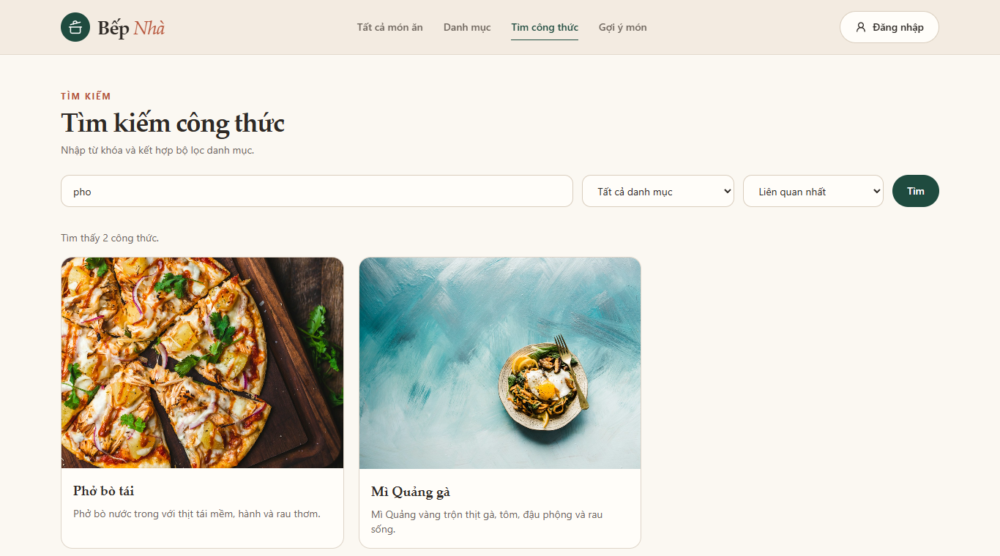
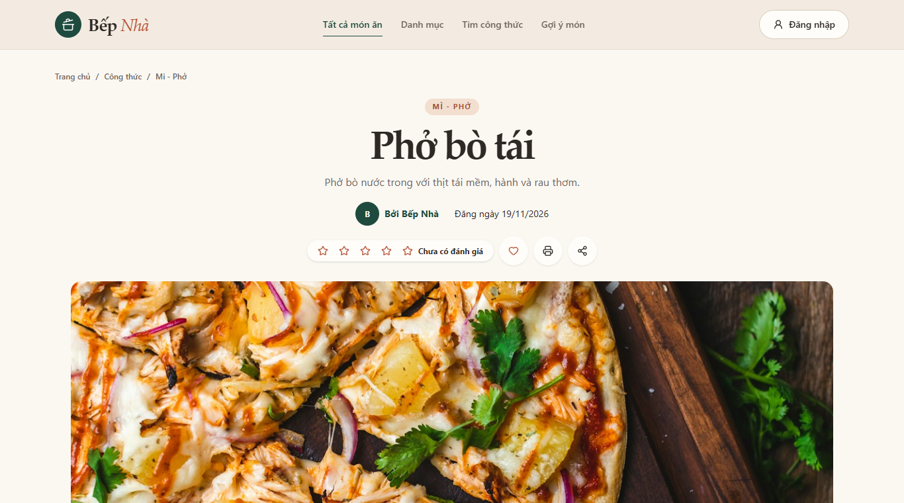
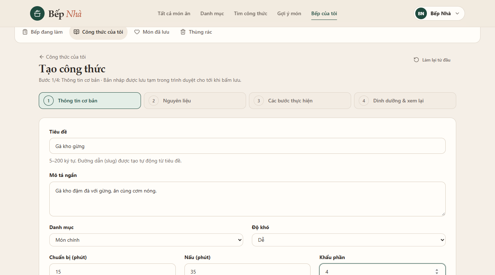
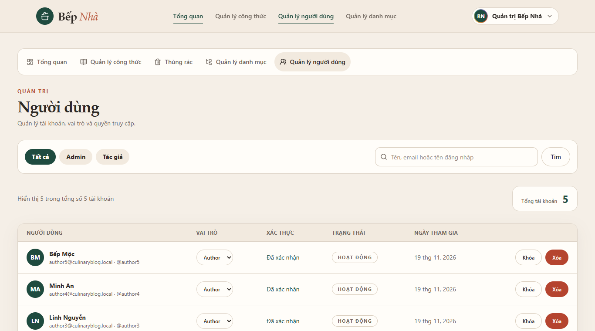

# CHƯƠNG 6. KẾT QUẢ VÀ ĐÁNH GIÁ

## 6.1. Kết quả tổng hợp

Hệ thống chạy trọn vẹn bằng Docker Compose gồm 10 dịch vụ (Nginx, frontend, API chính, Engagement, hai CSDL PostgreSQL, Redis, MinIO, Seq, MailHog) với dữ liệu mẫu và tài khoản mẫu. Các chức năng tạo thành một chu trình sử dụng hoàn chỉnh: tác giả đăng nhập, soạn và xuất bản công thức; khách tìm kiếm và xem; người dùng lưu món và đánh giá; quản trị viên quản lý người dùng và danh mục. Chi tiết phân công và trạng thái từng hạng mục được trình bày ở Chương 5.

## 6.2. Demo sản phẩm

**Tìm kiếm tiếng Việt không dấu.** Từ khóa `pho` trả về công thức "Phở bò tái", có thể kết hợp bộ lọc danh mục và sắp xếp.

*Hình 6.1. Tìm kiếm công thức bằng từ khóa không dấu*

**Trang chi tiết công thức.** Hiển thị ảnh, tác giả, nguyên liệu, các bước, đánh giá và nút lưu món; được render ở phía máy chủ để hỗ trợ SEO.

*Hình 6.2. Trang chi tiết công thức*

**Biểu mẫu tạo công thức.** Gồm bốn bước (thông tin cơ bản, nguyên liệu, các bước thực hiện, dinh dưỡng và xem lại), có lưu tạm trên trình duyệt và kiểm tra dữ liệu ở cả frontend lẫn backend.

*Hình 6.3. Biểu mẫu tạo công thức*

**Quản trị người dùng.** Quản trị viên tìm kiếm tài khoản, đổi vai trò, khóa, mở khóa hoặc xóa; hệ thống không cho quản trị viên tự khóa mình hay gỡ quyền của quản trị viên cuối cùng.

*Hình 6.4. Trang quản trị người dùng*

> *(Bổ sung khi có ảnh: Hình 6.5 đăng nhập, gồm đăng nhập Google; Hình 6.6 lỗi 409 khi sửa bằng phiên bản cũ.)*

## 6.3. Kiểm thử

Kiểm thử tự động backend (xUnit) gồm 42 trường hợp, tất cả đạt ngày 20/11/2026, bao phủ Auth, Category, Recipe, Engagement, Cache, công việc nền, middleware và quản lý người dùng. Frontend được kiểm tra kiểu bằng `tsc --noEmit` và không có lỗi. Giao diện được kiểm tra thủ công trên môi trường Docker Compose.

| Kịch bản | Kết quả mong đợi | Kết quả |
|---|---|---|
| Đăng nhập tài khoản mẫu | Vào đúng khu vực theo vai trò | Đạt |
| Tìm `pho` | Trả về "Phở bò tái" | Đạt |
| Tạo bản nháp, xuất bản | Bản nháp không hiện công khai; sau xuất bản có `PublishedAt` | Đạt |
| Sửa bằng phiên bản cũ | API trả 409, không ghi đè dữ liệu mới | Đạt |
| Tải ảnh sai định dạng hoặc quá lớn | API từ chối | Đạt |
| Đánh giá ngoài khoảng 1–5 | API từ chối | Đạt |
| Quản trị viên tự khóa mình | Hệ thống từ chối | Đạt |
| Đăng nhập Google | Tạo hoặc liên kết người dùng, cấp token của hệ thống | *(điền sau khi thử)* |

Trong quá trình kiểm thử tích hợp, nhóm phát hiện Nginx chuyển cả `/api/auth/*` (đường dẫn của Auth.js) sang backend nên trả 404, và đã bổ sung một `location` riêng trỏ về frontend. Lỗi này nằm ở ranh giới giữa các thành phần nên kiểm thử đơn vị không phát hiện được.

## 6.4. Đánh giá

**Điểm đạt được.**
- Đáp ứng các nhóm chức năng lõi của SRS, mỗi chức năng đều có đường sử dụng từ giao diện đến API.
- Kiến trúc modular monolith theo Clean Architecture và CQRS giúp ranh giới nghiệp vụ rõ; dịch vụ Engagement tách riêng minh họa cách xử lý dữ liệu và lỗi giữa hai dịch vụ.
- Bảo đảm toàn vẹn dữ liệu bằng kiểm soát đồng thời theo phiên bản (409), xóa mềm và chuyển trạng thái có điều kiện.
- Có khả năng vận hành: logging có cấu trúc, tracing, health check, công việc nền, cache chịu lỗi và hợp đồng OpenAPI.

**Hạn chế và hướng xử lý.**

| Hạn chế | Hướng xử lý |
|---|---|
| Google OAuth cần Client ID riêng cho mỗi môi trường | Có hướng dẫn cấu hình trong phụ lục cài đặt |
| TLS dùng chứng chỉ self-signed | Dùng chứng chỉ hợp lệ khi triển khai thật |
| Tạo công thức gồm nhiều yêu cầu liên tiếp, có thể lưu dở nếu một bước thất bại | Gộp thành một giao dịch hoặc thêm cơ chế khôi phục |
| Engagement gọi HTTP tới backend chính; bản chụp công thức đã lưu có thể cũ | Thêm hàng đợi sự kiện và thử lại |
| Chưa có kiểm thử giao diện tự động | Bổ sung Playwright cho các luồng chính |

**Bài học.**
- Nên chạy kiểm thử tích hợp sớm vì lỗi ở ranh giới giữa các thành phần không bị kiểm thử đơn vị phát hiện.
- Hợp đồng OpenAPI giúp frontend và backend làm song song, nhưng phải cập nhật cùng lúc với mã nguồn.
- Công việc nên chia nhỏ theo tuần và thực hiện qua pull request để tiến độ và đóng góp của từng thành viên thấy rõ ngay từ đầu, tránh dồn về giai đoạn tích hợp cuối.

## 6.5. Hướng phát triển

Bổ sung kiểm thử giao diện tự động, hàng đợi sự kiện cho Engagement, giao dịch gộp cho luồng tạo công thức, bình luận và theo dõi tác giả, đồng thời triển khai lên tên miền thật với chứng chỉ hợp lệ.
